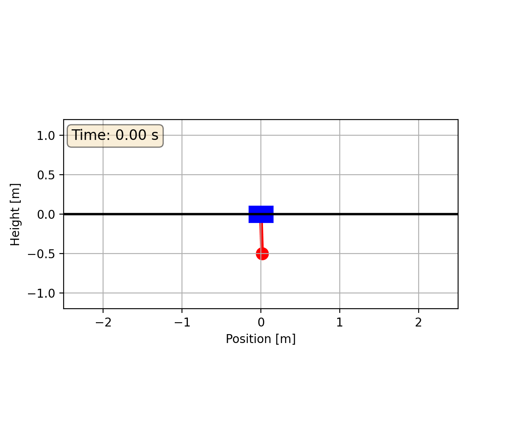
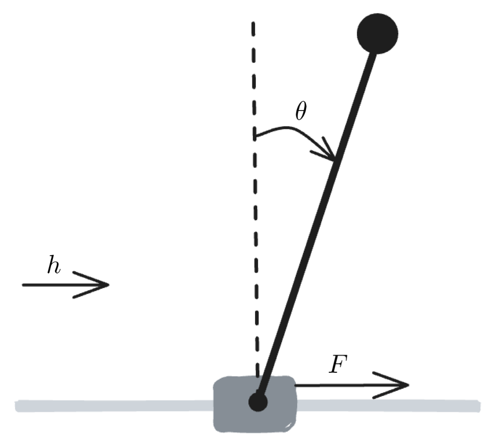
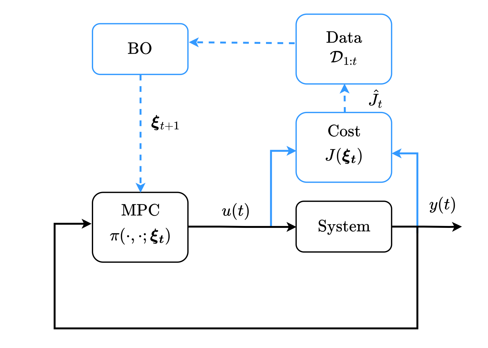
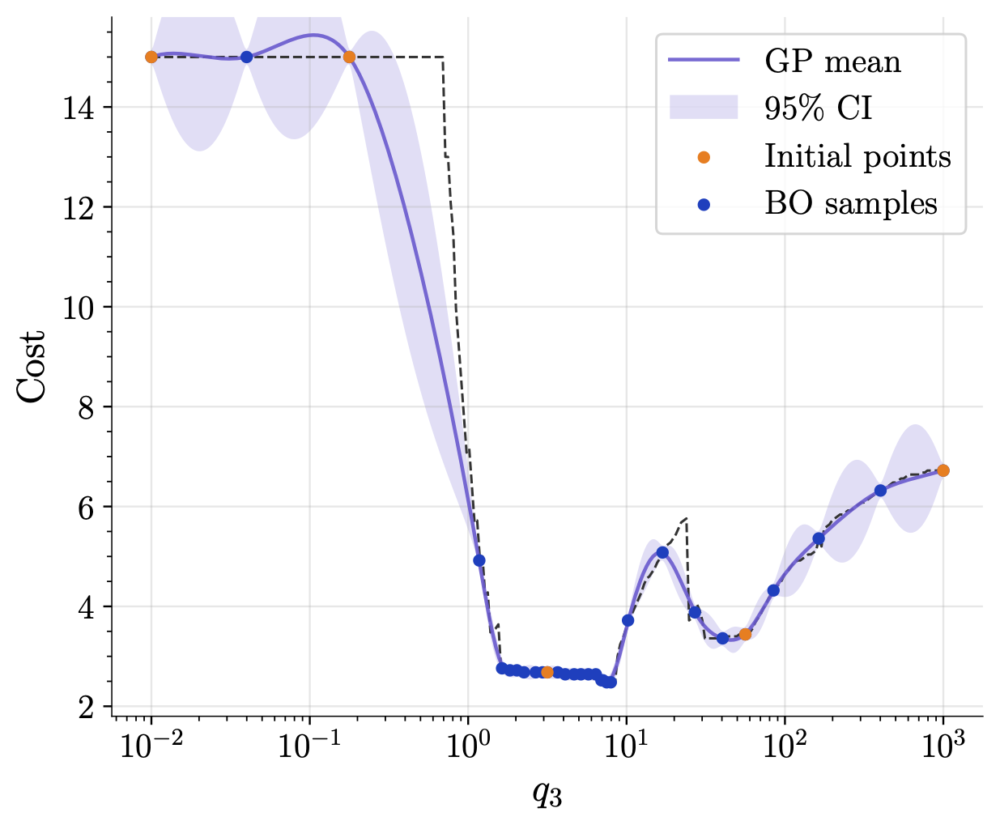
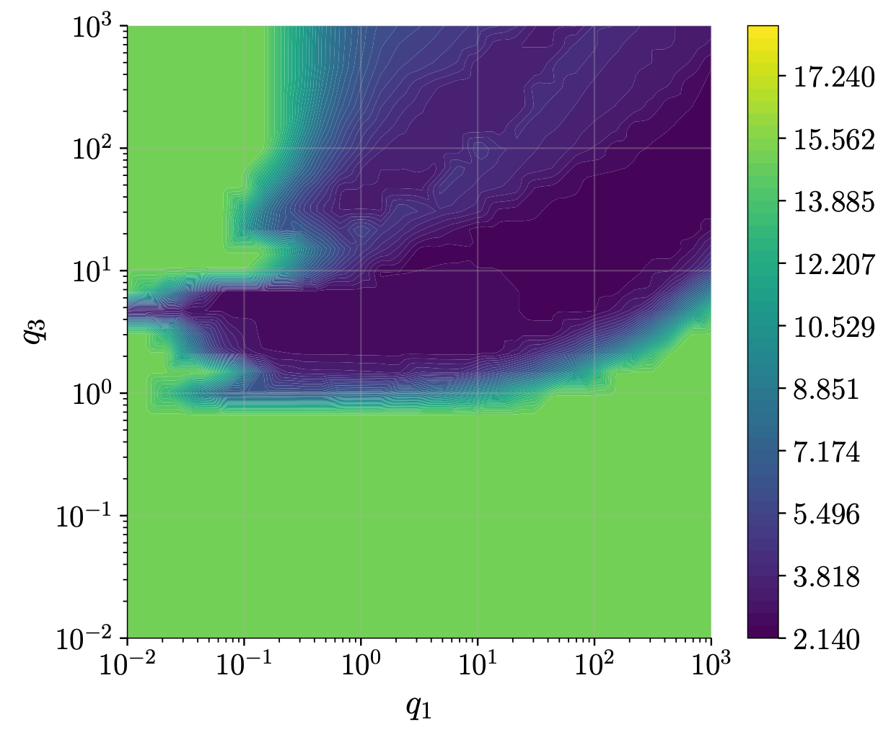
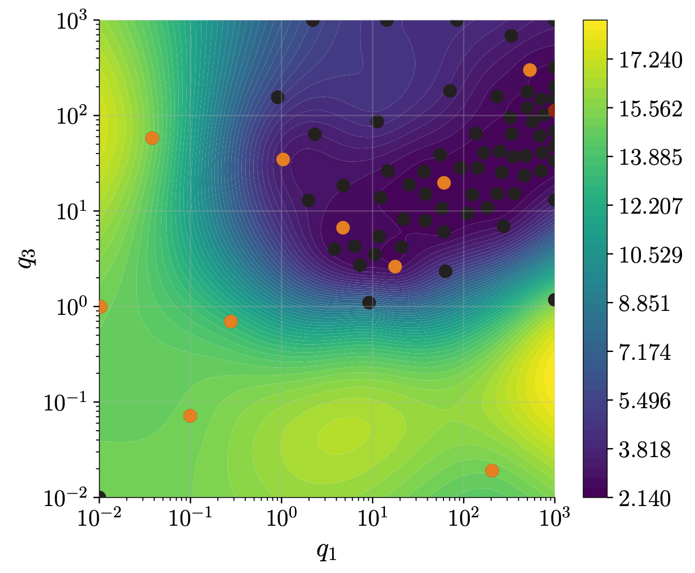
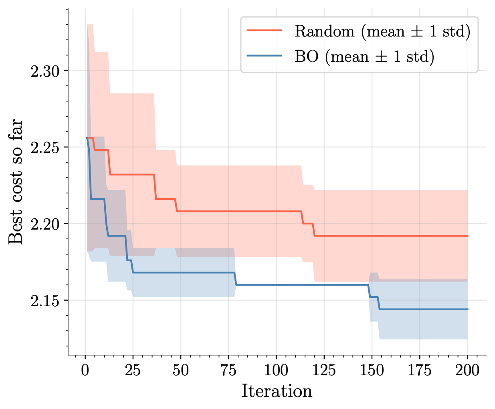

# MPC Tuning with Bayesian Optimization

<table align="center">
  <tr>
    <th width="33%">Minimum swing-up time</th>
    <th width="33%">Minimum effort</th>
    <th width="33%">Minimum swing-up time and effort</th>
  </tr>
  <tr>
    <td></td>
    <td></td>
    <td></td>
  </tr>
</table>
<p align="center"><em>Swing-ups with the BO-tuned weights (5D)</em></p>


Code of my bachelor thesis at TU Darmstadt. The cost weights of a nonlinear
model predictive controller (MPC) that swings up an inverted pendulum on a cart
are tuned automatically with Bayesian optimization (BO).

Hand-tuning MPC weights is slow and every closed-loop test is expensive.
Here, every BO evaluation is one simulated swing-up. A Gaussian-process
surrogate of the closed-loop performance decides which weights to try next.
The goal can be a fast swing-up, low control effort, or a trade-off of both.

## Setup

<p align="center"></p>

**Plant.** Cart (1 kg) with a pendulum (0.1 kg, 0.5 m), cart friction 0.5.
The pendulum starts hanging down (θ = 0.99π, where θ = 0 is upright).

**Controller.** Nonlinear MPC with [do-mpc](https://www.do-mpc.com) (orthogonal
collocation, horizon N = 50, Δt = 0.04 s, |F| ≤ 6 N, |h| ≤ 2 m). The weights
q1 to q4 and R enter the normalised stage cost

$$
\ell = q_1\left(\tfrac{h}{2}\right)^2 + q_2\left(\tfrac{\dot h}{2}\right)^2
     + q_3\left(\tfrac{1-\cos\theta}{2}\right)^2 + q_4\left(\tfrac{\dot\theta}{10}\right)^2
     + R\left(\tfrac{F}{6}\right)^2
$$

The terminal cost is the same without the R term, and changes of F are
penalised with weight 0.1.

**Episode.** A swing-up counts as successful when the pendulum is upright
(|θ| ≤ 0.01π) with the cart centred (|h| ≤ 0.2 m). The simulation stops after
2 s inside this goal, or when the time limit is reached.

**BO.** A GP with a Matérn-3/2 kernel and Log Expected Improvement (with
exploration offset ε) is implemented with [BoTorch](https://botorch.org).
The weights are searched in log scale, from 0.01 to 1000.

<p align="center"></p>

### The three objectives (BO costs)

| Objective  | BO cost                                        | Failure penalty | Time limit |
|------------|------------------------------------------------|-----------------|------------|
| `time`     | time to reach the goal t_goal                  | +2              | 15 s       |
| `effort`   | Σ (F / F_max)²                                 | +70             | 40 s       |
| `combined` | (1 − α) · effort + α · t_goal, α = 0.263       | +50             | 30 s       |

**Failure penalty.** Weights that never swing the pendulum up use almost no
input, so without a penalty they would be the global minimum of the effort
cost. The penalty lifts these runs above the successful ones. The time term
already punishes failed runs, since they use the full time limit, so `time` and
`combined` get smaller penalties. A larger one could hinder BO from locating
the minimum.

### Experiments

| Dimension | Tuned weights                                   | Initial points | BO iterations |
|-----------|-------------------------------------------------|----------------|---------------|
| 1D        | q3                                              | 5 (grid)       | 25            |
| 2D        | q1, q3 (`time`) · q3, R (`effort`, `combined`)  | 10 (Sobol)     | 65            |
| 5D        | q1, q2, q3, q4, R                               | 50 (Sobol)     | 200           |

The repository also contains:

- **Ground truth.** The true cost evaluated on a dense grid, to judge the GP.
- **BO vs. random search.** 5D, 5 runs with 250 evaluations each.
- **Pareto front.** Time vs. effort, sweeping α for the 1D problem.

All settings are in [`pendulum_mpc_bo/config.py`](pendulum_mpc_bo/config.py).

## Results

Best cost found by BO (lower is better):

| Dimension | `time` [s] | `effort` | `combined` |
|-----------|------------|----------|------------|
| 1D        | 2.48       | 7.52     | 9.96       |
| 2D        | 2.16       | 2.86     | 8.07       |
| 5D        | 2.12       | 7.75     | 8.19       |

- **Rough cost landscape.** Even in 1D the cost jumps in steps, because the MPC
  switches between swing-up modes (number of pre-swings, swing direction). In
  some ranges a tiny change of q3 flips the strategy.
- **Fewer, well-chosen weights win.** With a limited budget, a 2D pair matched
  to the objective beats tuning all five weights for `effort` and `combined`.
- **BO beats random search.** In 5D, BO reaches lower costs with less spread
  than random search on all three objectives.

Examples for the `time` objective:

**1D.** GP surrogate of the cost over q3 after 25 BO iterations.

<p align="center"></p>

**2D.** True cost (left) and GP surrogate (right) over (q1, q3); initial
points in orange, BO samples in black.

<p align="center">
  
  
</p>

**5D.** BO vs. random search, mean ± 1 std over 5 runs.

<p align="center"></p>

## Installation

Requires Python ≥ 3.12. With [uv](https://docs.astral.sh/uv/):

```bash
uv sync
```

or with pip:

```bash
python -m venv .venv && source .venv/bin/activate
pip install -e .
```

Plots use LaTeX fonts if LaTeX is installed. The scripts in
`experiments/illustrations/` need LaTeX.

## Usage

Prefix the commands with `uv run` if you use uv.

```bash
# Bayesian optimisation (default: thesis settings)
python experiments/run_bo.py --dim 1 --objective time
python experiments/run_bo.py --dim 2 --objective combined
python experiments/run_bo.py --dim 5 --objective effort --n-iter 50

# Dense-grid ground truth (cached in data/ground_truth/)
python experiments/ground_truth.py --dim 1 --objective effort
python experiments/ground_truth.py --params q3 --objective time --horizon 25

# BO vs. random search (5D)
python experiments/compare_bo_random.py --objective time
python experiments/compare_bo_random.py --from-cache data/bo_vs_random/5d_time.pkl

# Pareto front
python experiments/pareto_front.py --from-cache data/pareto/1d_q3.pkl

# Simulate / animate one swing-up with given weights
python experiments/simulate.py --animate
```

Figures and new results are saved to `results/`. One episode takes a few
seconds, so a 1D BO run finishes in minutes. 5D runs and dense grids take
hours, and the cached results in `data/` let you plot them without
recomputing.

## Repository structure

```
pendulum_mpc_bo/      library code
  config.py           all experiment settings
  simulator.py        pendulum model + do-mpc closed loop
  objectives.py       BO cost of one episode (time / effort / combined)
  bo.py               GP surrogate, LogEI, BO loop
  plotting.py         thesis plot style, figure saving
  animation.py        cart-pendulum animation
experiments/          runnable scripts (see Usage)
  illustrations/      GP / acquisition / Pareto figures of the background chapter
data/                 cached thesis results
assets/               README figures and animations
```

## License

[MIT](LICENSE)
